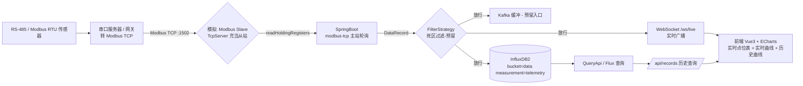

# 工业数据采集看板（IoT-Collect Demo）

Spring Boot 工业数据采集演示项目：**Modbus TCP 采集 → 数据过滤(Kafka 预留) → InfluxDB2 时序入库 → WebSocket 实时推送 → 前端可视化**。

---

## 一、架构图



**ASCII 版：**

```
  硬件层                       中转层                    软件采集层
 [RS-485/RTU 传感器] --> [串口服务器/网关] --Modbus-TCP--> [Modbus Slave TcpServer :1502]  (虚拟从站)
                                                                       |
                                                                       ▼
                                              [SpringBoot 后端 :8080]  digitalpetri modbus-tcp 主站
                                                ┌────────────────────────────────────────┐
                                                │ collector   @Scheduled 每秒轮询点位表      │
                                                │ filter      FilterStrategy(NoOp 透传,预留死区)│
                                                │ producer    DataProducer(Logging, 预留Kafka)│
                                                │ store       InfluxDataStore 写Influx+查询   │
                                                │ web         REST + WebSocket 实时推送        │
                                                └────────────────────────────────────────┘
                                                                    │
                                        ┌───────────────────────────┼──────────────────┐
                                        ▼                           ▼                  ▼
                                    [ Kafka 预留 ]           [( InfluxDB2 :8086 )]   [ WebSocket /ws/live ]
                                        (未接入)              bucket=data            实时广播
                                                                   │                     │
                                                                    │  Flux 查询           ▼
                                                                    ▼             [ 前端 Vite :5173 ]
                                                              /api/records ──> Vue3 + ECharts 实时看板
```

---

## 二、采集字段（点位表）

工程扫描的保持寄存器点位由 `src/main/resources/application.yml` 的 `app.modbus.points` 定义：

| 设备 | 点位 | slaveId | 寄存器起始地址 | 寄存器数量 | 数据类型 | 工程换算 | 单位 | 死区阈值(预留) |
|------|------|:------:|:------------:|:--------:|:------:|:---------:|:--:|:---:|
| sim-device-01 | temperature | 1 | 0 | 2 | FLOAT | ×1.0 | ℃ | 0.5 |
| sim-device-01 | pressure | 1 | 2 | 2 | FLOAT | ×1.0 | kPa | 2.0 |
| sim-device-01 | vibration | 1 | 4 | 2 | INT16 | ×0.01 | mm/s | 0.1 |

> 说明：
> - **FLOAT** 占 2 个寄存器（4 字节，IEEE754 大端）。
> - temperature 读寄存器 `0-1`、pressure 读 `2-3`、vibration 读 `4-5`。
> - 采集到的原始寄存器值 × `scale` 得到工程值后再入库/推送。vibration 因原始值是 INT16，乘 0.01 得 mm/s。
> - `deadband` 是死区过滤预留阈值（当前 `NoOpFilter` 透传，未启用）。

---

## 三、运行方式

| 服务 | 启动方式 | 地址 |
|------|---------|------|
| InfluxDB2 | 你本机已装并运行 `influxd` | `http://localhost:8086` (org=test / bucket=data) |
| Modbus 从站 | 打开 Modbus Slave → Connect 成 TcpServer | `:1502` |
| SpringBoot 后端 | `mvn spring-boot:run`（目录 D:\Project\data-collection） | `http://localhost:8080` |
| 前端看板 | `cd frontend && npm run dev` | `http://localhost:5173` |

---

## 四、如何让曲线"动起来"（修改 Modbus Slave 数据）

前端实时数据来自对从站文本的轮询。要让曲线出现起伏，改从站寄存器值即可。**重点记住所读地址**：temperature=`0-1`、pressure=`2-3`、vibration=`4-5`。

在 **Modbus Slave 的 3X Holding Registers 表格**里：

1. **temperature（读到寄存器 0-1，FLOAT）**
   - 按住 `Ctrl` 同时点选第 0、1 行（两个相邻寄存器）
   - 右键 → **Set... / 数据格式 → Float**（确保以 Float 解读）
   - 输入例如 `25.0`，回车确认

2. **pressure（寄存器 2-3，FLOAT）**
   - 选中第 2、3 行 → 右键设 **Float** → 输入 `101.3`

3. **vibration（寄存器 4-5，INT16，后端再 ×0.01）**
   - 选中第 4、5 行 → 输入整数（原始值），例如 `680` → 后端显示 `6.80` mm/s

> Modbus Slave 里设置 FLOAT：
> - 如果右键菜单有 **"Write"**，选中后逐个输入数字；
> - 有些版本需先对选中单元格设 **格式/数据类型 = Float**（菜单 Setup → Address/You can right-click → 设置类型），再输入值。
> - **只有你修改的会在下一次轮询（约1秒后）体现到前端。**

**想让曲线持续波动**（当前版本 Modbus Slave 静态值不会自动变）：
- 方式A：手动每隔几秒改一次寄存器数字 → 曲线出现阶跃。
- 方式B：用 **Modbus Poll** 作为第二个主站，周期性地往从站写变化的值（更方便模拟真实传感器）。
- 方式C：后续可在点表加扰动，或接真实设备。

---

## 五、项目结构（后端）

```
src/main/java/com/demo/iotcollect/
├── IotCollectApplication.java      # 启动类 (@EnableScheduling @ConfigurationPropertiesScan)
├── config/
│   ├── ModbusProperties.java        # 从站/点位表配置绑定(app.modbus)
│   ├── InfluxProperties.java        # influx url/token/org/bucket 绑定
│   ├── InfluxConfig.java            # InfluxDBClient Bean(按 influx.enabled 条件装配)
│   ├── ProducerConfig.java          # DataProducer Bean(当前 LoggingProducer, 预留 Kafka)
│   └── WebSocketConfig.java         # 注册 /ws/live
├── model/
│   ├── DevicePoint.java             # 点位定义 + DataType 枚举
│   └── DataRecord.java              # 采样记录 record(device,name,value,unit,timestamp)
├── collector/
│   ├── ModbusClientService.java     # ModbusTcpClient 封装: 惰性连接+自动重连, byte[]大端解码
│   └── CollectScheduler.java        # @Scheduled 每秒轮询点位 → 过滤→出口/入库/广播
├── filter/
│   ├── FilterStrategy.java          # 过滤接口(预留死区)
│   └── NoOpFilter.java              # 透传
├── producer/
│   ├── DataProducer.java            # 数据出口接口(预留 Kafka)
│   └── LoggingProducer.java         # 日志输出
├── store/
│   ├── InfluxDataStore.java         # 写 Influx + Flux 查询(时间/类型健壮解析)
│   └── TimeSeriesPoint.java         # 时序点 DTO
└── web/
    ├── RecordController.java        # GET /api/points, /api/records
    └── LiveHub.java                 # WebSocket Handler + 广播
```

**前端：** `frontend/`（Vite + Vue3 + ECharts + axios），单页看板含实时点位表、实时曲线、历史查询。

---

## 六、常见问题

- **前端实时表/曲线为空**：检查后端是否在跑（8080）、从站是否连上（后端日志无 `Connection refused`）、以及浏览器访问的是 `localhost:5173`（WebSocket 直连 `localhost:8080`）。
  > **历史坑（已修复）**：`LiveHub` 曾用裸 `new ObjectMapper()` 广播，因 `DataRecord.timestamp` 是 `Instant`、未注册 jackson JSR310 模块，每次序列化抛 `InvalidDefinitionException` 被 `catch` 吞掉，帧从未发出（`/api/records` 正常而 WebSocket 为空）。现改为注入 Spring 托管的 `ObjectMapper`（自带 `JavaTimeModule`，与 `RecordController` 同一实例）。若再现"REST 正常、实时为空"，优先怀疑序列化/异常被吞。
- **Modbus Slave 每约 10 分钟自动断**：用 TcpServer 长连接空闲超时所致，需重新 Connect。
- **Kafka / 死区过滤**：均为预留位，当前 `NoOp` 透传、`LoggingProducer` 输出到日志。